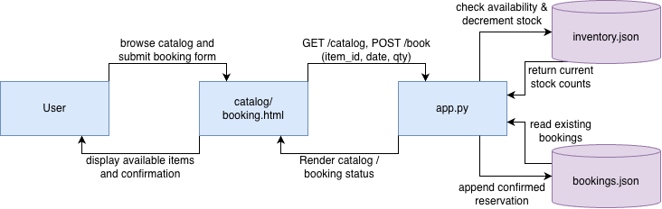

# Table & Chairs Rental Marketplace

A centralized web platform that connects event organizers with local party rental providers to check live equipment inventory and coordinate reservations.

## The Problem

Planning events and private parties often involves delays when trying to reserve tables and chairs across multiple vendors. Organizers lack a centralized marketplace to instantly verify real-time availability and coordinate delivery without manual requests.

## How It Works

The platform acts as a bridge between event planners and rental inventories. Users can browse a live catalog of available tables and chairs, check real-time item counts, and submit booking requests stored securely via local data persistence.

## Tech Stack

- **Language:** Python
- **Web Framework:** Flask
- **Frontend:** HTML, CSS (Tailwind framework), and JavaScript
- **Data Storage:** Local JSON files (`data/inventory.json` and `data/bookings.json`); initial inventory is seeded from sample table and chair listings and loaded/initialized on startup.
- **Version Control:** Git & GitHub

## Roadmap
- [ ] Vendor Dashboard: Separate login portal for rental businesses to manage their own inventory
- [ ] Review & Rating System: Ratings and reviews for rental providers
- [ ] Automated Email Reminders: Booking confirmation and delivery reminder emails

